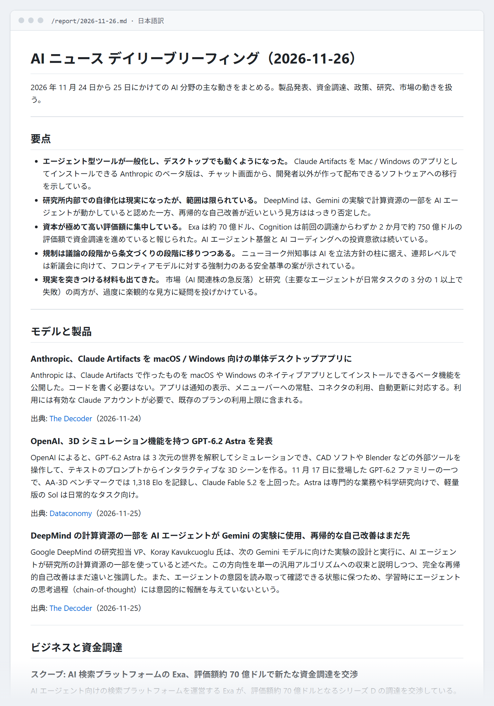
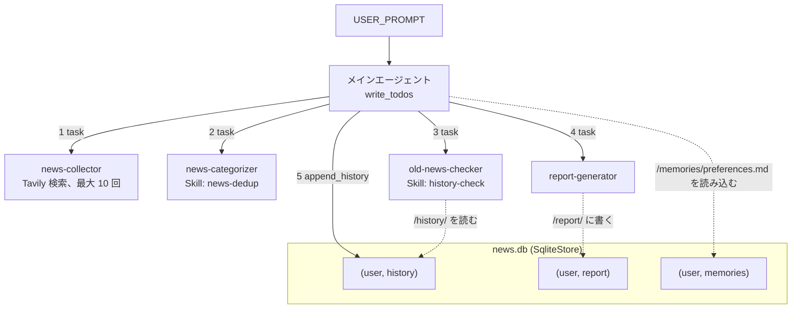

# AI News Deep Agent

[English](README.md) | 日本語 | [中文](README.zh-CN.md)

AI ニュースの日次レポートを作成するマルチエージェントシステム。最新のニュースを検索し、重複と過去のレポートで扱った記事を除いて、元記事へのリンク付きの Markdown レポートを書く。履歴、レポート、長期記憶はユーザーごとに分けて保存する。



[レポート全文](docs/examples/2026-11-26.ja.md)

## 主な機能

- 4 つのサブエージェントによるパイプライン（ニュース収集、重複排除、過去のレポートとの照合、レポート作成）
- レポートの各記事に元記事へのリンクと公開日を表示
- 掲載したニュースを履歴に記録し、次回の実行で除外
- 履歴、レポート、長期記憶をユーザーごとに分離
- コマンドラインと LangGraph API サーバーの両方で実行可能

## 工夫した点

### ユーザーごとの名前空間

永続化するパスは、ユーザー ID から始まる名前空間に分けて SQLite に保存する。

| エージェント内のパス | `news.db` 内の名前空間 |
| --- | --- |
| `/history/` | `(user, "history")` |
| `/report/` | `(user, "report")` |
| `/memories/` | `(user, "memories")` |

ユーザー ID は [`identity.py`](identity.py) の `user_namespace` 1 か所で決まる。LangGraph サーバーでは認証済みユーザー、SDK から呼ぶ場合は `context={"user_id": ...}` の値を使う。サーバーに認証を追加すれば、エージェント、ツール、保存処理のコードを変えずに複数ユーザーに対応できる。

### 書き込みをコードで制御

- 履歴に追記できるのは `append_history` ツールだけ。ツールは行の形式を検証し、既存の行はスキップする。`/history/**` と `/skills/**` へのファイルツールの書き込みは拒否している。
- 保存先、名前空間、権限はコードで決めている。モデルが決めるのは、何を検索し何を書くかだけ。

### サブエージェントごとのコンテキスト分離

- 各サブエージェントは独自のコンテキストで動き、Pydantic の `NewsList` を返す。記事のタイトル、URL、日付がステップ間で崩れない。
- 重複排除と過去ニュースとの照合は Skill（`SKILL.md`）として定義し、各サブエージェントは自分の Skill だけを読み込む。

## アーキテクチャ



## 使用技術

| 技術 | 用途 |
| --- | --- |
| Python 3.12 | 実行環境 |
| Deep Agents 0.7.25 | サブエージェント、Skill、パスごとの保存先の振り分け、ファイル権限 |
| LangGraph 1.2.15 / LangChain 1.4.6 | Store、チェックポインター、API サーバー、検索回数の上限などのミドルウェア |
| DeepSeek（OpenAI 互換 API） | ツール呼び出しに対応したモデル。`BASE_URL` で他の OpenAI 互換モデルにも切り替え可能 |
| Tavily | 期間を指定できるニュース検索 |
| SQLite | コマンドラインとサーバーで共有する 1 つのファイル `news.db` |
| Pydantic 2 | サブエージェント間で受け渡す構造化出力 |
| LangSmith | トレース |
| uv | 依存パッケージのバージョン固定 |

## テスト

`demo.py` は LangGraph API 経由でパイプライン全体を実行し、委任の順序、Skill の読み込み、履歴の形式、レポート内のリンクなど 7 項目を確認する。`demo_users.py` は 2 人のユーザーとしてエージェントを実行し、長期記憶が分かれて保存されることを確認する。2026-11-26 に空のデータベースから実行し、どちらも合格した（7/7、115 秒、および 4/4）。

## 動かし方

前提条件は Python 3.11 以上、ツール呼び出しに対応した OpenAI 互換のモデル API、[Tavily](https://tavily.com) の API キー。

```bash
git clone https://github.com/ryukirin/ai-news-deep-agent.git
cd ai-news-deep-agent
python -m venv .venv
source .venv/bin/activate     # Windows PowerShell: .venv\Scripts\Activate.ps1
pip install -r requirements.txt
cp .env.example .env          # MODEL_NAME、DEEPSEEK_API_KEY、BASE_URL、TAVILY_API_KEY を記入
python agent.py
```

API サーバーとテストを実行する場合:

```bash
agentseek dev
uv run --no-project python demo.py          # 別のターミナルで実行
uv run --no-project python demo_users.py
```

設定、サーバー、保存先の構成、既知の制限は[詳細ガイド](docs/guide.ja.md)に記載している。

## 背景

Datawhale の講座 [Deep Agents 实战](https://github.com/datawhalechina/deepagents-in-action)（CC BY-NC-SA 4.0）の第 2 章から第 9 章に沿って開発した個人プロジェクト。講座の例から変更した点は[詳細ガイド](docs/guide.ja.md#講座との対応)にまとめている。
