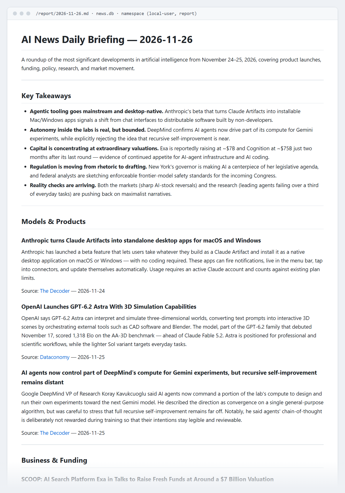
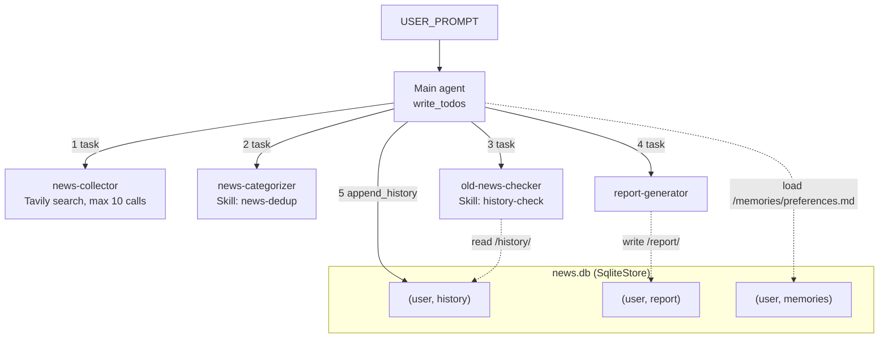

# AI News Deep Agent

English | [日本語](README.ja.md) | [中文](README.zh-CN.md)

A multi-agent system that writes a daily AI news report. It searches the latest news, removes duplicates and stories that earlier reports already covered, and writes a Markdown report with links to the original articles. History, reports and long-term memory are stored separately for each user.



[Full report](docs/examples/2026-11-26.md)

## Features

- Pipeline of 4 subagents: collect news, remove duplicates, check against past reports, write the report
- Each article in the report links to its source and shows its publication date
- History of reported news, so the next run skips stories that were already reported
- Separate history, reports and long-term memory for each user
- Runs from the command line or on the LangGraph API server

## Design decisions

### Per-user namespaces

Each persistent path is stored in SQLite under a namespace that starts with the user ID.

| Path in the agent | Namespace in `news.db` |
| --- | --- |
| `/history/` | `(user, "history")` |
| `/report/` | `(user, "report")` |
| `/memories/` | `(user, "memories")` |

The user ID is resolved in one function, `user_namespace` in [`identity.py`](identity.py). On the LangGraph server it is the authenticated user, and from the SDK it is `context={"user_id": ...}`. Adding authentication to the server makes the agent multi-user without changes to the agent, the tools or the storage code.

### Writes controlled in code

- The history can only be appended through the `append_history` tool, which checks the line format and skips existing lines. File tools are denied on `/history/**` and `/skills/**`.
- Storage locations, namespaces and permissions are set in code. The model decides only what to search and what to write.

### Isolated context for each subagent

- Each subagent runs in its own context and returns a Pydantic `NewsList`, so the title, URL and date of each article stay intact between steps.
- Deduplication and the past-news check are Skills (`SKILL.md`). Each subagent loads only its own Skill.

## Architecture



## Tech stack

| Technology | Used for |
| --- | --- |
| Python 3.12 | Runtime |
| Deep Agents 0.7.25 | Subagents, Skills, routing each path to its own storage backend, file permissions |
| LangGraph 1.2.15 / LangChain 1.4.6 | Store, checkpointer, API server, middleware such as the search call limit |
| DeepSeek (OpenAI-compatible API) | Model with tool calling. Other OpenAI-compatible models work through `BASE_URL` |
| Tavily | News search with a time range |
| SQLite | One file, `news.db`, shared by the command line and the server |
| Pydantic 2 | Structured output passed between subagents |
| LangSmith | Tracing |
| uv | Pinned dependencies |

## Testing

`demo.py` runs the whole pipeline through the LangGraph API and checks 7 items, including the delegation order, Skill loading, the history format and the links in the report. `demo_users.py` runs the agent as two users and checks that their memories are kept apart. On 2026-11-26, starting from an empty database, both passed (7/7 in 115 seconds, and 4/4).

## Getting started

Requirements: Python 3.11 or later, an OpenAI-compatible model API with tool calling, and a [Tavily](https://tavily.com) API key.

```bash
git clone https://github.com/ryukirin/ai-news-deep-agent.git
cd ai-news-deep-agent
python -m venv .venv
source .venv/bin/activate     # Windows PowerShell: .venv\Scripts\Activate.ps1
pip install -r requirements.txt
cp .env.example .env          # Fill in MODEL_NAME, DEEPSEEK_API_KEY, BASE_URL and TAVILY_API_KEY
python agent.py
```

To run the API server and the tests:

```bash
agentseek dev
uv run --no-project python demo.py          # in another terminal
uv run --no-project python demo_users.py
```

Configuration, the server, the storage layout and known limitations are in the [detailed guide](docs/guide.md).

## Background

Personal project, built while following chapters 2 to 9 of the Datawhale course [Deep Agents 实战](https://github.com/datawhalechina/deepagents-in-action) (CC BY-NC-SA 4.0). The parts beyond the course examples are listed in the [detailed guide](docs/guide.md#mapping-to-the-course).
