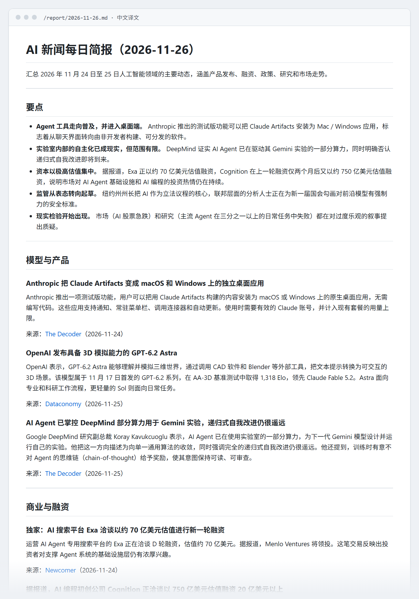
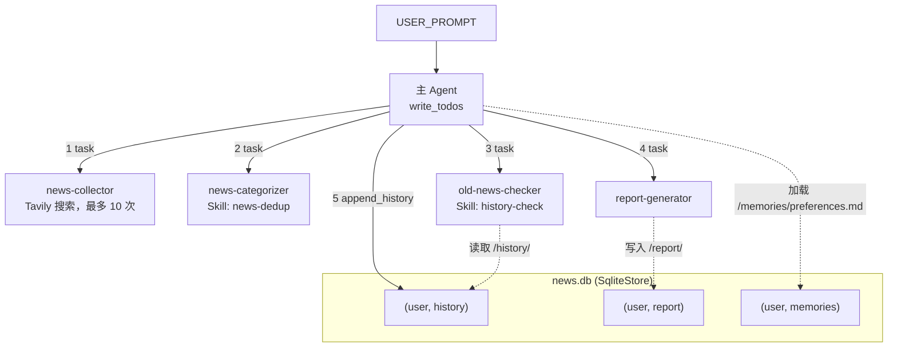

# AI News Deep Agent

[English](README.md) | [日本語](README.ja.md) | 中文

生成 AI 新闻日报的多 Agent 系统。搜索最新新闻，去掉重复新闻和以往报告已经写过的新闻，写出带原文链接的 Markdown 报告。历史记录、报告和长期记忆按用户分开保存。



[报告全文](docs/examples/2026-11-26.zh-CN.md)

## 主要功能

- 由 4 个子 Agent 组成的流水线（收集新闻、去重、与以往报告比对、撰写报告）
- 报告中每条新闻都附原文链接和发布日期
- 已报道的新闻记入历史记录，下次运行自动跳过
- 历史记录、报告和长期记忆按用户隔离
- 可在命令行运行，也可部署在 LangGraph API 服务上

## 设计要点

### 按用户划分命名空间

需要持久化的路径存入 SQLite，命名空间以用户 ID 开头。

| Agent 中的路径 | `news.db` 中的命名空间 |
| --- | --- |
| `/history/` | `(user, "history")` |
| `/report/` | `(user, "report")` |
| `/memories/` | `(user, "memories")` |

用户 ID 只由 [`identity.py`](identity.py) 中的 `user_namespace` 决定。在 LangGraph 服务上使用认证用户，从 SDK 调用时使用 `context={"user_id": ...}` 的值。给服务加上认证即可支持多用户，Agent、工具和存储代码都不需要修改。

### 用代码控制写入

- 历史记录只能通过 `append_history` 工具追加，工具会校验每行格式并跳过已有的行。文件工具对 `/history/**` 和 `/skills/**` 的写入被拒绝。
- 存储位置、命名空间和权限都在代码中确定，模型只决定搜索什么、写什么。

### 子 Agent 上下文隔离

- 每个子 Agent 在独立的上下文中运行，返回 Pydantic 的 `NewsList`，新闻的标题、URL 和日期在步骤之间保持完整。
- 去重和旧闻比对写成 Skill（`SKILL.md`），每个子 Agent 只加载自己的 Skill。

## 架构



## 技术栈

| 技术 | 用途 |
| --- | --- |
| Python 3.12 | 运行环境 |
| Deep Agents 0.7.25 | 子 Agent、Skill、按路径分配存储后端、文件权限 |
| LangGraph 1.2.15 / LangChain 1.4.6 | Store、checkpointer、API 服务、搜索次数上限等中间件 |
| DeepSeek（OpenAI 兼容 API） | 支持工具调用的模型，可通过 `BASE_URL` 换成其他 OpenAI 兼容模型 |
| Tavily | 可指定时间范围的新闻搜索 |
| SQLite | 命令行和服务共用一个文件 `news.db` |
| Pydantic 2 | 子 Agent 之间传递的结构化输出 |
| LangSmith | 链路追踪 |
| uv | 固定依赖版本 |

## 测试

`demo.py` 通过 LangGraph API 运行整条流水线，核对委派顺序、Skill 加载、历史记录格式、报告中的链接等 7 项。`demo_users.py` 以两个用户的身份运行 Agent，核对长期记忆分开保存。2026-11-26 从空数据库开始运行，两者都通过（7/7，用时 115 秒，以及 4/4）。

## 运行方法

前置条件为 Python 3.11 及以上、支持工具调用的 OpenAI 兼容模型 API，以及 [Tavily](https://tavily.com) 的 API key。

```bash
git clone https://github.com/ryukirin/ai-news-deep-agent.git
cd ai-news-deep-agent
python -m venv .venv
source .venv/bin/activate     # Windows PowerShell: .venv\Scripts\Activate.ps1
pip install -r requirements.txt
cp .env.example .env          # 填写 MODEL_NAME、DEEPSEEK_API_KEY、BASE_URL、TAVILY_API_KEY
python agent.py
```

启动 API 服务并运行测试：

```bash
agentseek dev
uv run --no-project python demo.py          # 在另一个终端运行
uv run --no-project python demo_users.py
```

配置、服务、存储结构和已知限制见[详细说明](docs/guide.zh-CN.md)。

## 背景

个人项目，按 Datawhale 课程 [Deep Agents 实战](https://github.com/datawhalechina/deepagents-in-action)（CC BY-NC-SA 4.0）第 2 至 9 章的内容开发。课程示例之外的改动见[详细说明](docs/guide.zh-CN.md#与课程的对应)。
